## INTRODUCTION

In this project, the purpose is to complete the simulation model especially classic DC/DC type converter and after that we will do another simulation for DC/DC converter but this time it will be improved version.
It will be really useful and advantageous for me to see, analyze, and simulate DC/DC converters since they are used a lot in many areas nowadays. For specific applications we need to design with parameters. For example, I choose switching frequency selection, duty cycle selection and more First let me talk about some of the known DC/DC Converters.

    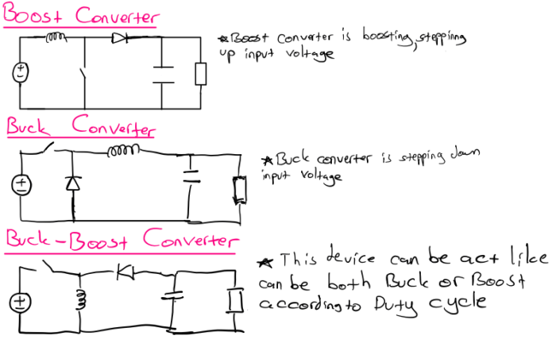

    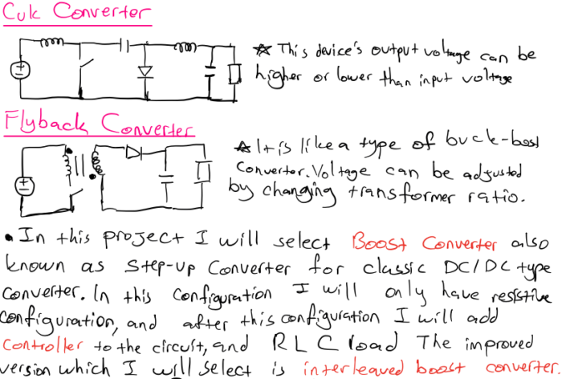

## Step-Up(Boost) Converter

### DESIGN

    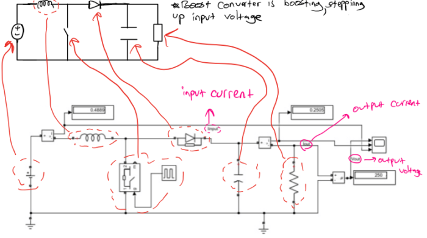

    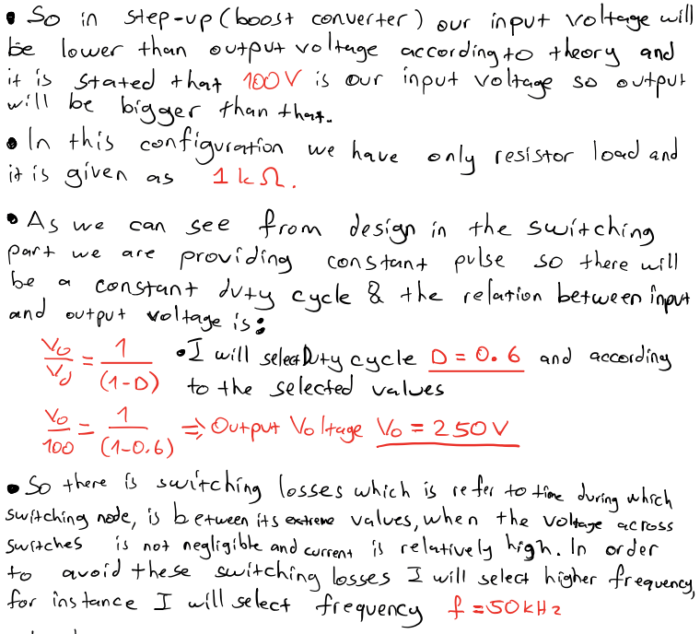

    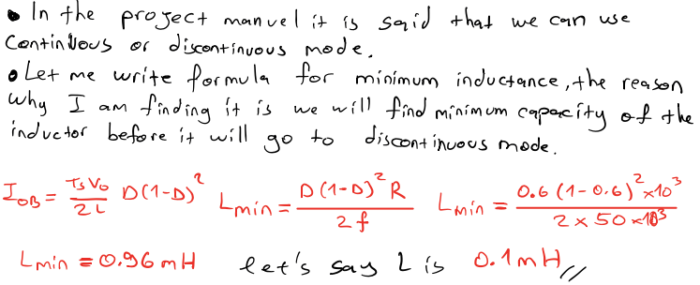

    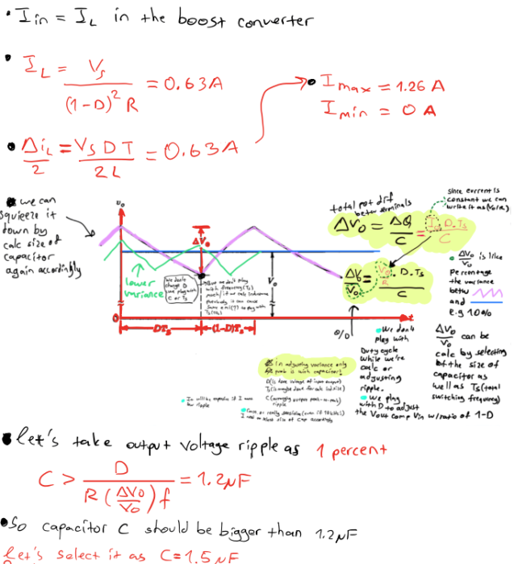

### SIMULATIONS

    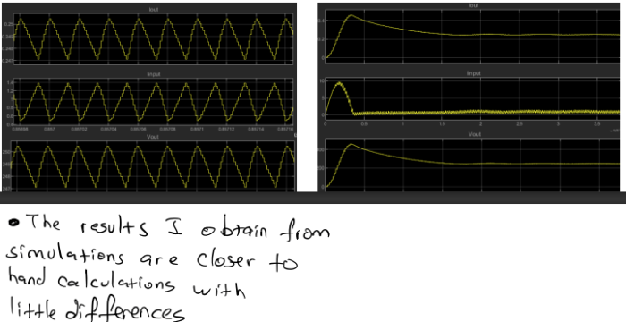

##  Step-Up(Boost) Converter With PID Controller

### DESIGN

    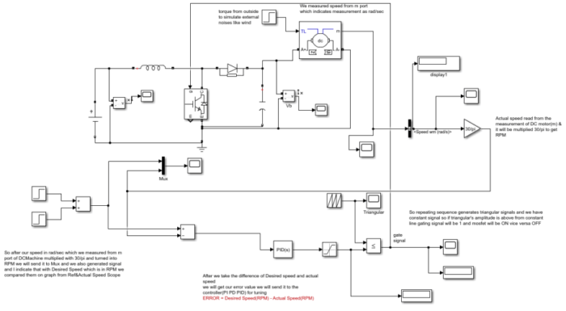

    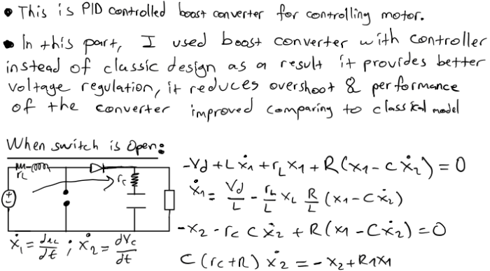

    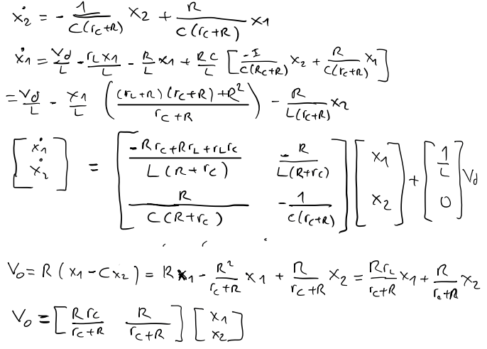

    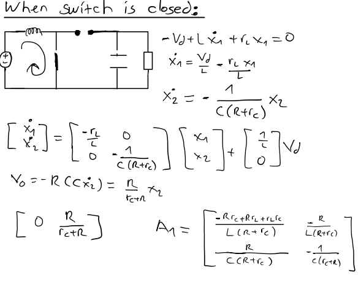

    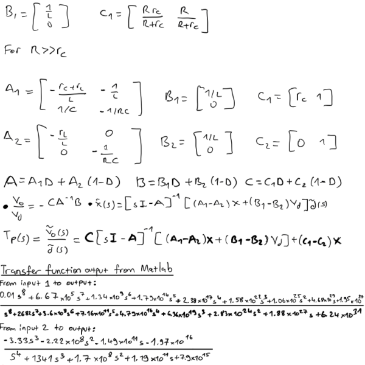

### SIMULATIONS

    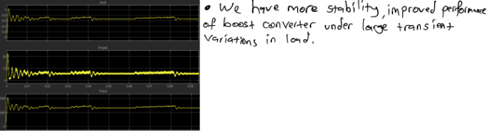

##  Interleaved Step-Up(Boost Converter)

### DESIGN

    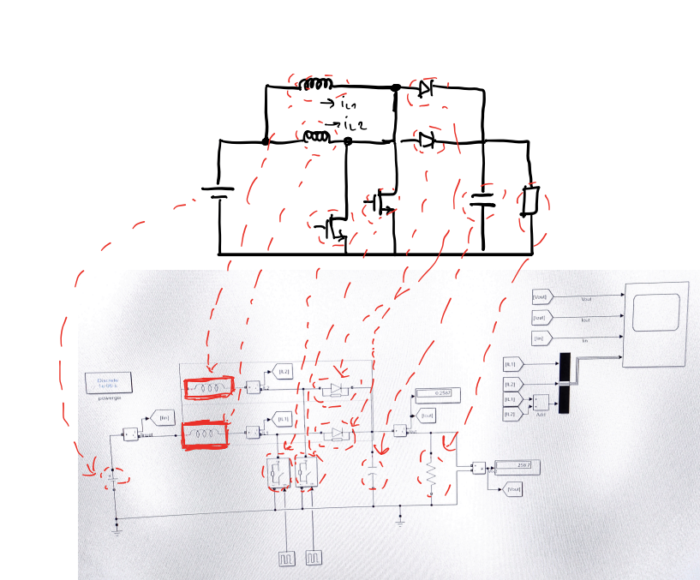

    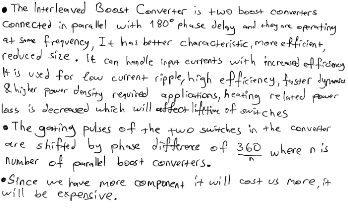

    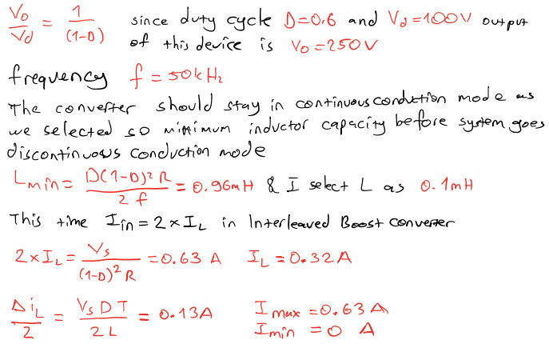

    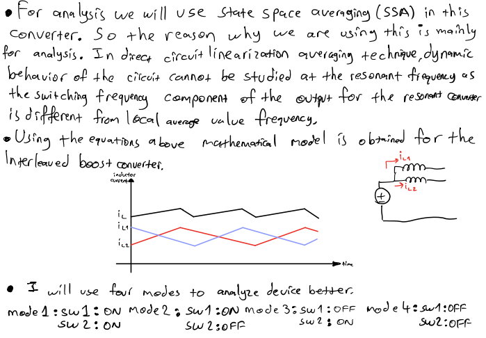

    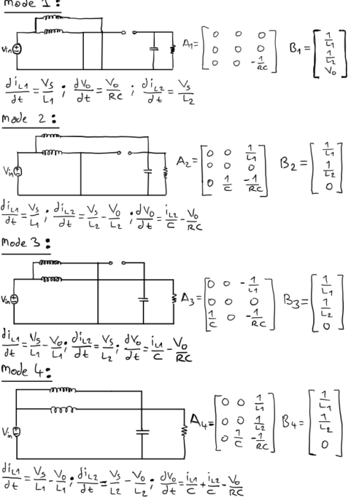

    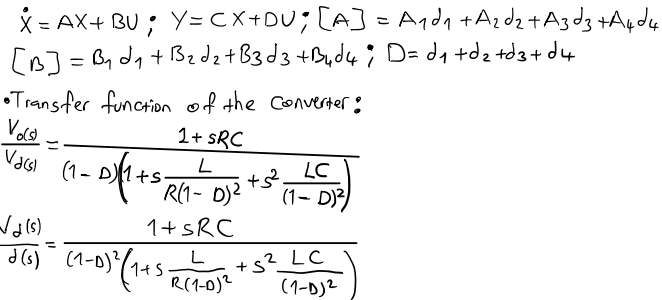

### SIMULATIONS

    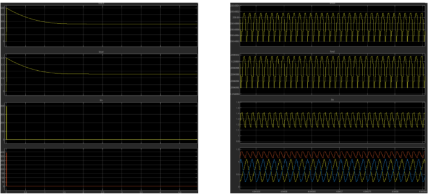

##  CONCLUSION 

    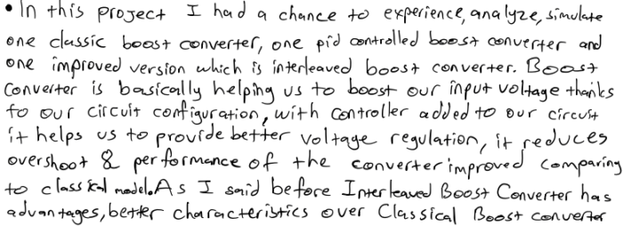

    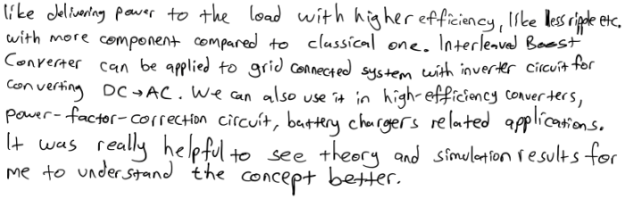

## REFERENCES

    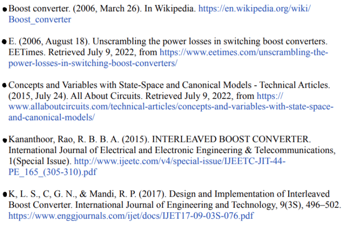

