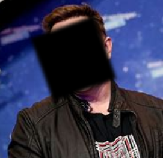
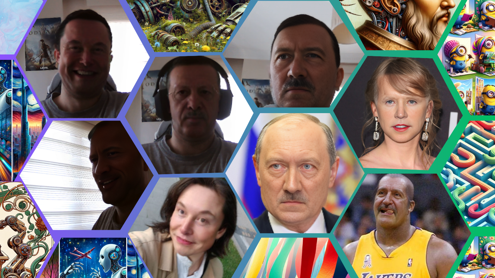

While I was browsing through the repositories of github I saw this deep live cam and it was becoming popular so I wanted to see what stage we are at in this technology, and the best way to do this is to try it by testing etc. rather than researching, so I installed it locally.

## Installation

While I was trying to install it from [here](https://github.com/hacksider/Deep-Live-Cam) I had problems. I recommend you to be strict about following instructions, for example I had 3 different python versions 3.12, 3.11, and 3.9 so I thought python part is fine but when I tried to install required packages/modules I had a lot of problems after I solved the problems related with this another problem come up now I had black square on my face like this

<div class="image-container" style="text-align: center;">
    
</div>

on live and direct test and finally I decided to install python 3.10 as repo recommends, and my development platform is windows so I also installed [ffmpeg](https://www.youtube.com/watch?v=OlNWCpFdVMA), pip, git etc. and visual studio 2022 runtimes.

After you are ready you can clone the repository to your local and then we need to install 2 models to models folder inside repo and then we need to install requirements via requirements.txt, I highly recommend you to install via virtual env because you will face with a lot of version problems along the way if you have other versions etc. in you development environment 

### How to solve black square problem
* This can be solved via following;
    * onnx runtime isnt compatible, `onnxruntime==1.18.0` so check this maybe this can be the problem
      ```
      pip install onnxruntime==1.18.0
      ```

    * try redownloading the models([GFPGANv1.4](https://huggingface.co/hacksider/deep-live-cam/resolve/main/GFPGANv1.4.pth) && [inswapper_128_fp16.onnx](https://huggingface.co/hacksider/deep-live-cam/resolve/main/inswapper_128_fp16.onnx))

    * The following solution solved my black square problem.
      ```
      pip uninstall onnxruntime
      pip uninstall onnxruntime-gpu
      pip uninstall onnxruntime-directml
      pip install onnxruntime-directml==1.15.1
      ```
        * Btw this solution is for windows, and I tried on cpu directly.

## Test 
Now that the hard part is done, it's time for the fun stuff. Let me show you the results. This is one of the best I've seen so far!

Run the following command in you terminal.
```
python run.py --execution-provider cpu
```
I combined all the outputs together in the first image, and in the second image I tried to show live demo.

<div class="image-container" style="text-align: center;">
    
</div>

<br>

<div class="image-container" style="text-align: center;">
    
</div>

<br>
<br>

**Connect with me across the web, you can explore my digital world through the link on the image below, including more articles, projects, and personal interests.**

[](https://linktr.ee/yavuzertugrul?utm_source=linktree_profile_share&ltsid=ca29e9eb-5683-4ea5-8d64-4369abf718df)
