## What is Lidar?

Remote sensing technology which uses laser light to measure distances to objects and surfaces. It is simply emitting laser pulses which bounce off objects and return to sensor. It looks similar isn't it, Radar also emits bouncing from objects but it uses radio waves, both of them use of TOF idea(Time of Flight) of signal and  change in frequency (Doppler shift) to calculate distance, speed, and direction of object. However, there are key differences;


*  **Resolution:** Lidar has a higher resolution and can provide more detailed information about environment.<br>
*  **Range:** Lidar can detect objects at longer ranges<br>
*  **Interference:** Lidar is less susceptible to interference from other sources, making it more suitable for applications in complex environments.
<div class="image-container" style="text-align: center;">
    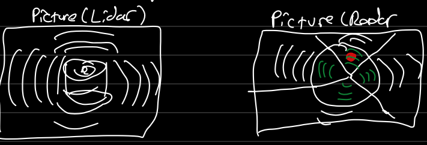
</div>
Many of you have probably encountered a Lidar system without even realizing it. Lidar technology plays a crucial role in autonomous vehicles, with companies such as Zoox, Cruise, and Waymo equipping their self-driving cars with multiple units. Beyond the automotive industry, Lidar is widely used in topographic mapping and surveying, with organizations like Geosurvey and Leica relying heavily on this technology.


## How Lidar Works?

<div class="image-container" style="text-align: center;">
    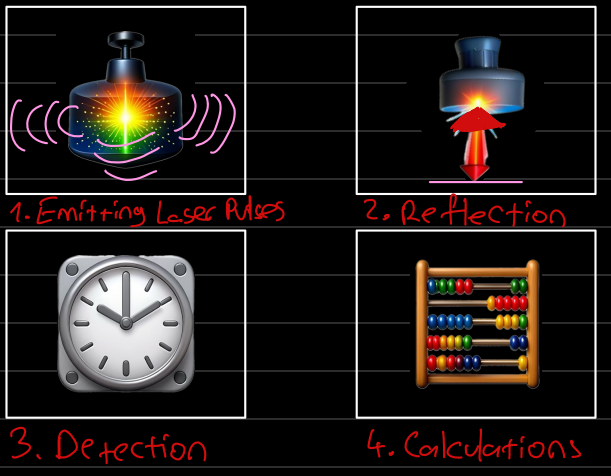
</div>


## Velodyne VLP-16 Lidar ROS2 Humble Test on NVIDIA Jetson Orin Nx 8 GB

### Hardware Setup
**1. Network Connection**  
> Connect VLP-16 to Jetson Orin NX through the Ethernet port. Make sure Jetson is powered!  
> You can connect through SSH (`ssh [username]@[address]`) or use an external monitor directly.


**2. Power Connection**  
> Power-Up VLP-16 via 12 V adapter


### System Requirements
* Update and Upgrade packages
```bash
sudo apt update 88 sudo apt upgrade -y
```


* Install basic tools & ROS2 Dependencies
```bash
sudo apt install -y git python3-pip python3-colcon-common-extensions
```


<div style="display: flex; justify-content: center; gap: 20px;">
    <div class="image-container" style="width: 45%;">
        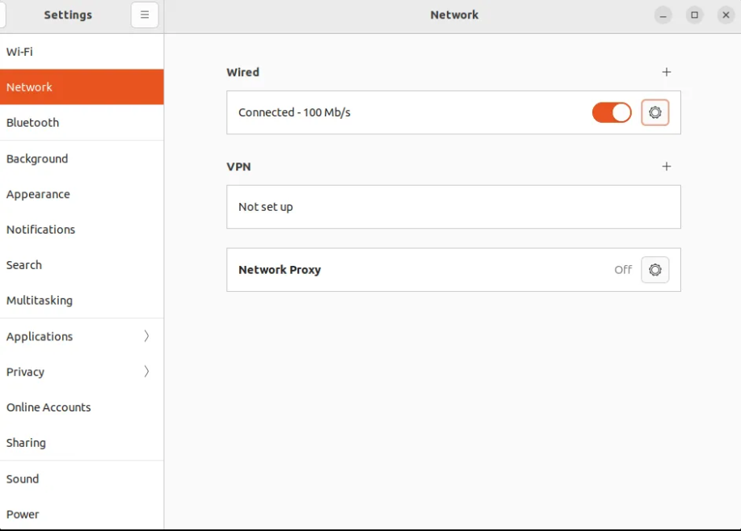
    </div>
    <div class="image-container" style="width: 45%;">
        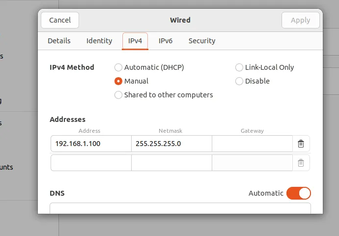
    </div>
</div>


* We need to add IPv4 manually
* Let's set IP address field to 192.168.1.100 ("100" can be any number you want in range between 1-254 except 201 since it is velodyne vlp-16's)
* Set netmask to 255.255.255.0 & Gateway to 0.0.0.0


Add static route to Lidar's IP address
```bash
sudo route 192.168.XX.YY eth0 #192.168.1.201
```


also from network configuration .yaml we can do this
```bash
sudo nano /etc/netplan/01-netcfg.yaml
```


<div class="image-container" style="text-align: center;">
    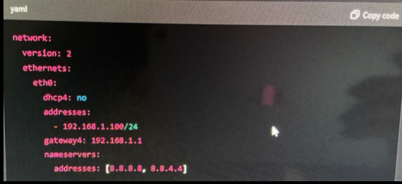
</div><br>
to confirm 

```bash
ip a | grep etho
```


* Disable WIFI
    * Open http://192.168.1.201 


<div style="display: flex; justify-content: center; gap: 20px;">
    <div class="image-container" style="width: 45%;">
        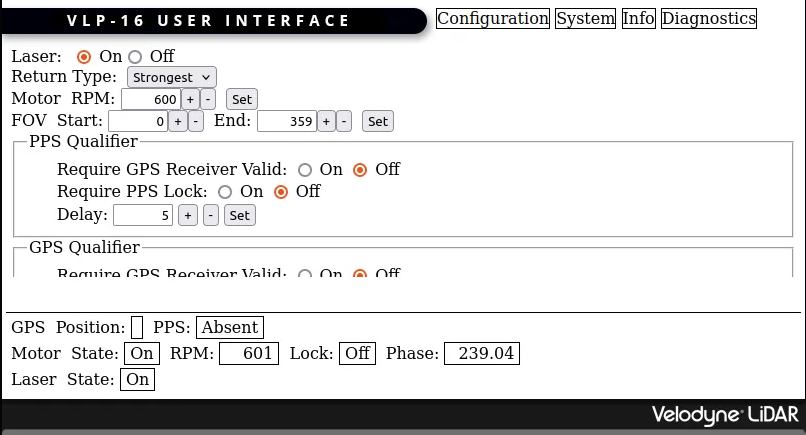
    </div>
    <div class="image-container" style="width: 45%;">
        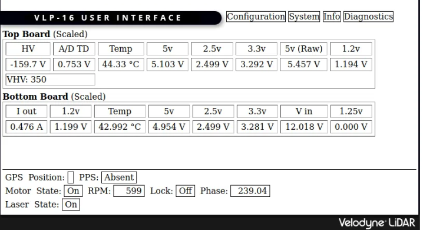
    </div>
</div>


### Install ROS2 Humble
* Set locale
  ```bash
  locale  # check for UTF-8

  sudo apt update
  sudo apt install locales
  sudo locale-gen en_US en_US.UTF-8
  sudo update-locale LC_ALL=en_US.UTF-8 LANG=en_US.UTF-8
  export LANG=en_US.UTF-8

  locale  # verify settings
  ```


* Add apt repository & GPG key
  ```bash
  sudo apt install software-properties-common
  sudo add-apt-repository universe

  sudo apt update
  sudo apt install curl -y
  sudo curl -sSL https://raw.githubusercontent.com/ros/rosdistro/master/ros.key -o /usr/share/keyrings/ros-archive-keyring.gpg

  echo "deb [arch=$(dpkg --print-architecture) signed-by=/usr/share/keyrings/ros-archive-keyring.gpg] http://packages.ros.org/ros2/ubuntu $(. /etc/os-release && echo $UBUNTU_CODENAME) main" | sudo tee /etc/apt/sources.list.d/ros2.list > /dev/null
  ```
    

* Install ROS2 packages
  ```bash
  sudo apt update && sudo apt upgrade -y
  ```


* Install ROS2 Humble and Development tools(This has ROS, RViz, demos, tutorials etc.)
  ```bash
  sudo apt install ros-humble-desktop
  sudo apt install ros-dev-tools
  ```
    

* Source ROS2 in terminal (if you don't want to do this everytime you open terminal add this to bashrc and source it)
  ```bash
  source /opt/ros/humble/setup.bash
  ```
    


### Velodyne Driver Installation
There are two ways to install
> Building from source


> Via deb packages (apt...)


* I will show you "building from source"
  ```bash
  mkdir -p ~/ros2-ws/src
  cd ~/ros2-ws/src
  git clone -b humble-devel https://github.com/ros-drivers/velodyne.git
  cd ~/ros2-ws
  rosdep install --from-paths src --ignore-src -y
  colcon build
  source install/setup.bash #also if you don't want to do this everytime source it in bash
  ```


also you can do this by installing deb package

```bash
sudo apt install ros-$ROS_DISTRO-velodyne
```


### Testing the Device & Visualizing the Data
To visualize we will use RViz2
```bash
sudo apt install -y ros-humble-rviz2
```
According to your need and device you can launch one of the nodes:


<div class="image-container" style="text-align: center;">
    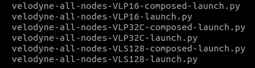
</div><br>
Launch vlp-16 node:

```bash
ros2 launch velodyne velodyne-all-nodes-VLP16-launch.py
```


Let's see topics:

```
ros2 topic list
```

<div class="image-container" style="text-align: center;">
    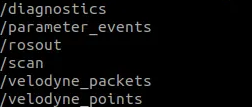
</div><br>

```bash
ros2 topic echo /velodyne_points
ros2 topic echo /velodyne_packets
```


<div style="display: flex; justify-content: center; gap: 20px;">
    <div class="image-container" style="width: 45%;">
        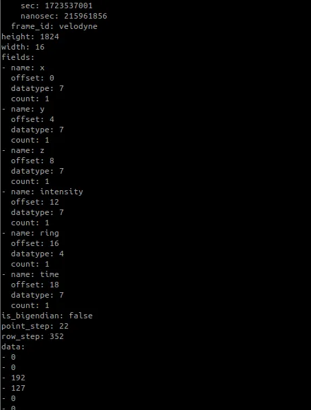
    </div>
    <div class="image-container" style="width: 31%;">
        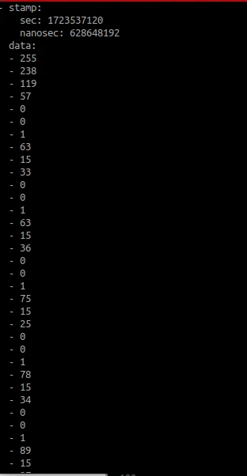
    </div>
</div>


### Visualisation

```bash
ros2 run rviz2 rviz2 -f velodyne
```
or you can open rviz2 directly and change settings like fixed frame from `/map` to `/velodyne`


<div style="display: flex; justify-content: center; gap: 20px;">
    <div class="image-container" style="width: 45%;">
        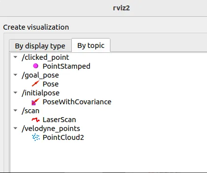
    </div>
    <div class="image-container" style="width: 38%;">
        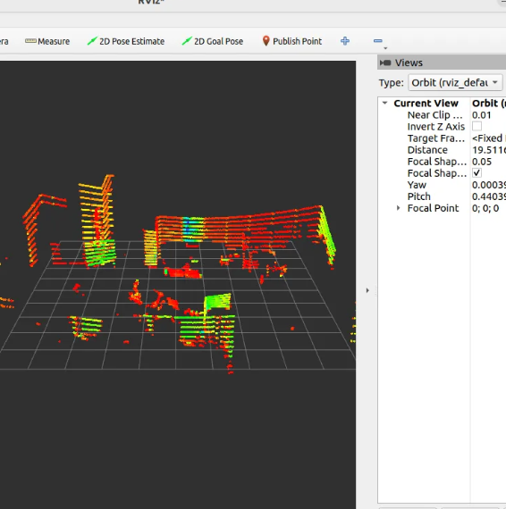
    </div>
</div>


<div class="image-container" style="text-align: center; width: 80%; margin: 0 auto;">
    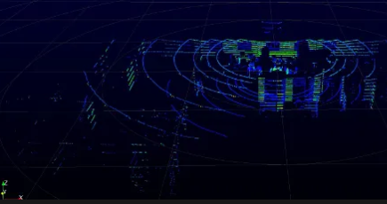
</div><br>


**Connect with me across the web, you can explore my digital world through the link on the image below, including more articles, projects, and personal interests.**

[](https://linktr.ee/yavuzertugrul?utm_source=linktree_profile_share&ltsid=ca29e9eb-5683-4ea5-8d64-4369abf718df)
